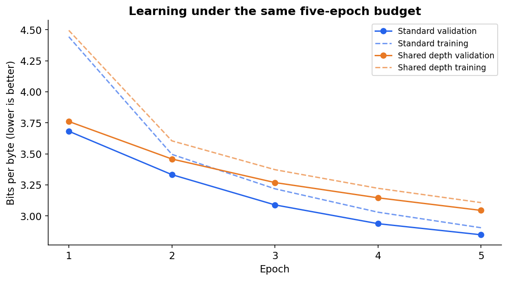
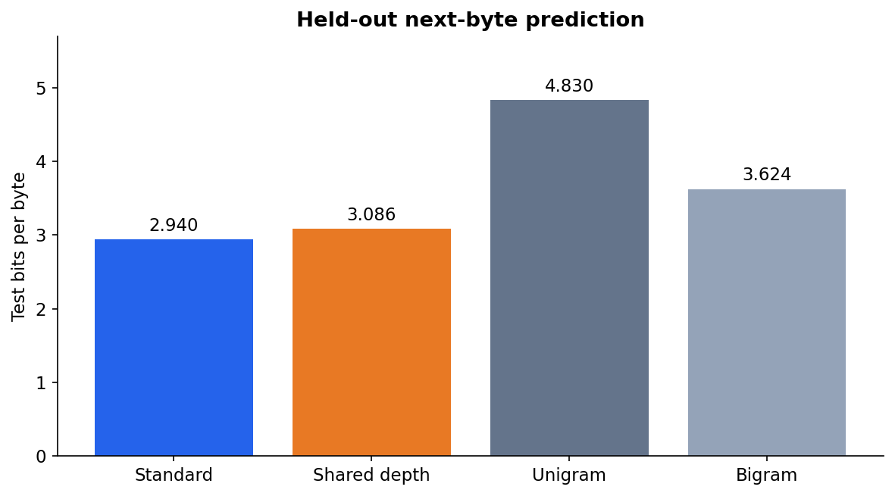
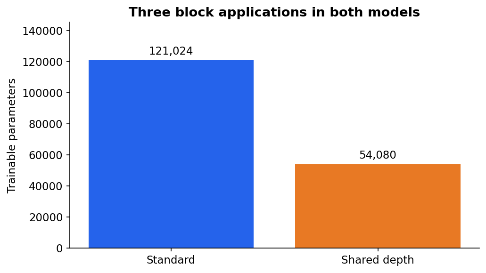
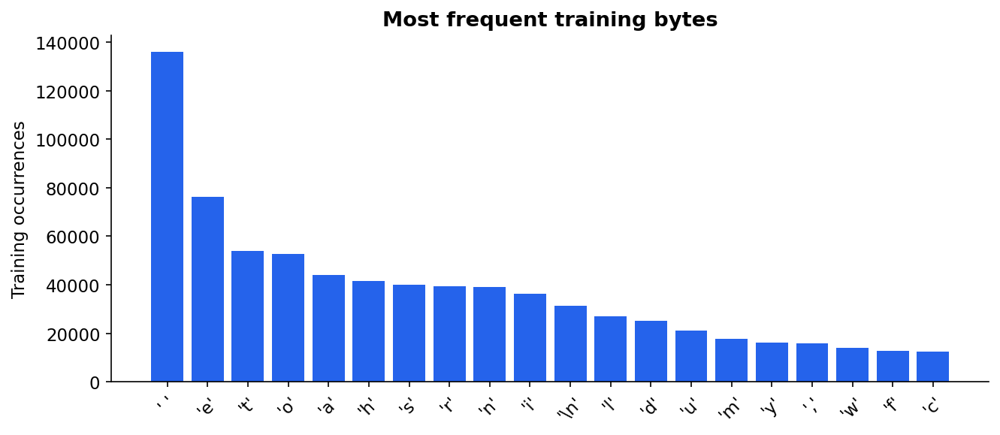
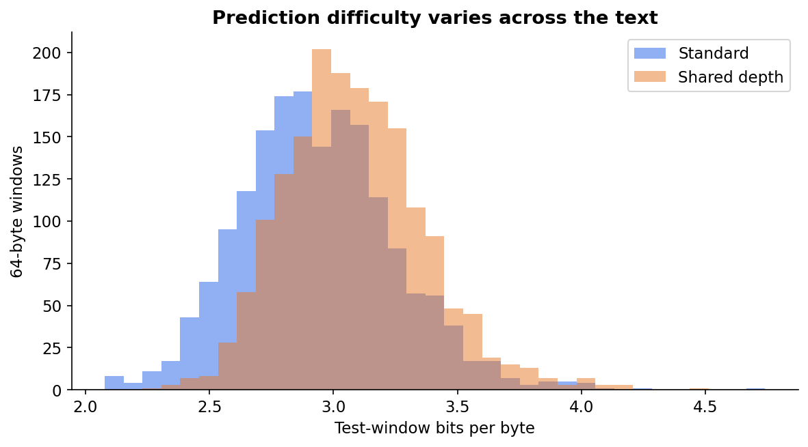
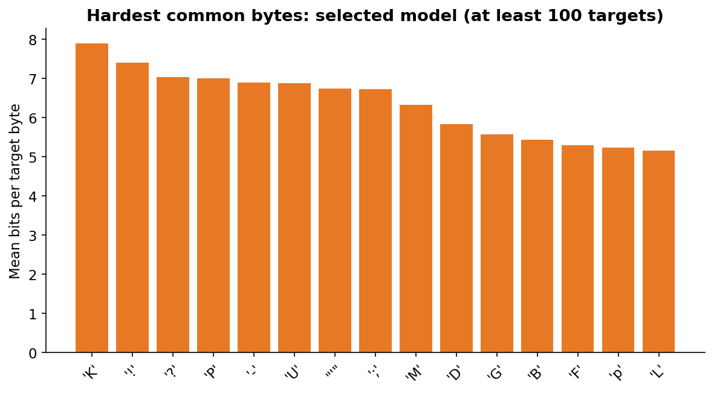

# Shared-Depth Byte Language Models in TensorFlow

Train language models from scratch on Shakespeare to measure the accuracy–parameter tradeoff of reusing a Transformer block.

---

## Overview

* **Question:** Can one Transformer block applied three times retain next-byte prediction quality with fewer parameters than three distinct blocks?
* **Task:** Autoregressive byte-level language modeling.
* **Dataset:** 1,115,394 raw bytes; 256 possible byte IDs; 64-byte context windows.
* **Selected Model:** **Standard Transformer** (test bits per byte = **2.9398**, lower is better), selected using validation loss.
* **Baseline Comparison:** Smoothed bigram achieved test bits per byte = 3.6243; unigram = 4.8300.

This is a small, executed study of an architectural idea relevant to LLMs, not a large general-purpose assistant. It uses TensorFlow without pretrained weights, external LLM calls, or a learned tokenizer.

---

## Key Results

### Training Validation

One contiguous validation partition is used instead of cross-validation. Fold standard deviations are not applicable.

| Model | Validation bits per byte | Selected epoch |
| :--- | ---: | ---: |
| Standard Transformer | 2.8478 | 5 |
| Shared-depth Transformer | 3.0443 | 5 |
| Unigram baseline | 4.7716 | N/A |
| Bigram baseline | 3.6019 | N/A |

### Final Holdout Evaluation (111,488 Target Bytes)

| Model | Bits per byte ↓ | Byte perplexity ↓ | Next-byte accuracy ↑ |
| :--- | ---: | ---: | ---: |
| Standard Transformer | 2.9398 | 7.6732 | 40.62% |
| Shared-depth Transformer | 3.0856 | 8.4892 | 37.49% |
| Unigram baseline | 4.8300 | 28.4429 | 14.90% |
| Bigram baseline | 3.6243 | 12.3315 | 26.48% |

Sharing reduces trainable parameters from **121,024 to 54,080 (55.3%)**. Its test BPB difference relative to the standard model is **+0.1458**; a positive difference means worse prediction. Both execute three attention/FFN applications, so fewer parameters do not imply proportionally less computation. The observed training wall times include validation and checkpoint writing and are not controlled speed benchmarks.

### Architecture and Evaluation Protocol

Both models have width 64, four attention heads, feed-forward width 128, learned position embeddings, pre-layer normalization, causal attention, tied input/output embeddings, and dropout 0.1. The standard model owns three distinct blocks; the shared-depth model invokes one block three times. It has no adaptive halting or depth embeddings.

The raw corpus is split 80%/10%/10% in source order **before** constructing windows. No window crosses a partition boundary. Each complete window supplies 64 next-byte targets, with stride 64 and reset context; targets do not overlap within a partition. The first byte supplies context only, and incomplete tails are excluded. This is a custom split, not an official benchmark split.

Each model receives five epochs, batch size 64, Adam learning rate 0.001, global gradient clipping at 1.0, and fixed seed 42. Validation loss chooses checkpoints and the selected architecture before the test partition is scored. Both prespecified architectures and two count baselines are reported on identical test targets. Count baselines use training text only and additive smoothing 0.1. BPB is mean negative log probability divided by ln(2); byte perplexity is exp(mean NLL).

Training curves average losses while weights are changing and dropout is active; validation is measured after each epoch with dropout disabled. Their difference is therefore not a pure estimate of the generalization gap. Checkpoint reload and a future-token perturbation check verify identical inference and causal masking on saved examples; all reported test losses are independently recalculated from window records.

---

## Data Summary

* **Source:** [Tiny Shakespeare, curated by Andrej Karpathy](https://github.com/karpathy/char-rnn/blob/6f9487a6fe5b420b7ca9afb0d7c078e37c1d1b4e/data/tinyshakespeare/input.txt), pinned source commit `6f9487a6fe5b420b7ca9afb0d7c078e37c1d1b4e`.
* **Data Quality:** 1,115,394 bytes fully decoded as UTF-8; 65 distinct byte values. No imputation, deduplication, or text normalization. Repeated phrases are retained because they are part of the text.
* **Partitions:** 13,942 training windows, 1,742 validation windows, and 1,742 test windows. Exact offsets and unused tails appear in `splits.json`.
* **Integrity:** All source bytes match the pinned Git blob SHA; SHA-256 is recorded in `data_sources.json`. The corpus is referenced rather than republished.
* **Interpretability:** Permutation feature importance and tabular correlations are not appropriate here. `byte_errors.csv` reports target-byte difficulty; it is not a causal explanation.

### Error Analysis and Limitations

The selected model's hardest target among bytes with at least 100 test occurrences is `'K'`, with mean 7.890 bits and 167 occurrences. Per-window losses and accuracies are retained for all four models in `error_analysis.csv`.

All six generated continuations are preserved in `generated_samples.json`: three predetermined prompts per neural model, 256 new bytes each, temperature 0.8, and seeds 42–44. They are model outputs, not curated examples or evidence of reasoning. Raw output bytes are also retained as hexadecimal strings. Byte prediction does not guarantee grammatical or meaningful generation.

This is one seed, a short context, one small literary corpus, and a fixed short budget. Contiguous partitions can differ in characters and style, while repeated phrases may cross partitions; this is not a held-out-author or held-out-play evaluation. No statistical significance, general knowledge, reasoning, multilingual ability, or large-scale efficiency claim is made. A 256-byte vocabulary accepts arbitrary UTF-8 input but does not demonstrate multilingual learning on this predominantly English corpus.

### Actual Generated Text

The first predetermined prompt from each model is shown below without selecting for quality. Non-printable/non-ASCII output is escaped for display; raw bytes are preserved in the JSON artifact. These continuations can contain invented words, broken syntax, and inconsistent meaning.

**Standard Transformer — first predetermined prompt**

```text
ROMEO:
Thou with house mastintor madiny heand sish!
He seabling paire, so hard that sore thang,
Seo hear buth with as dee? pringe mand ande.


VORCESTER:
No that shear we pour weart anwn, up the shough,
That you ear of doth bure-ruet of bethis tcaus.

Seed:
What 
```

**Shared-depth Transformer — first predetermined prompt**

```text
ROMEO:
Thou wis lever en thinste, I spuled be sloserik,
An's the cand the hand tham rens; a are maske picest.
Thind the nerrear, I and and of Ie theat leard
That sheas that ther mer''ds streast ares as coud treaal-sand dorld
Wheent warld my wish brome the lite fo
```

---

## Visualizations

| Learning curves | Holdout performance |
| :---: | :---: |
|  |  |

| Parameter count | Training-byte distribution |
| :---: | :---: |
|  |  |

| Window-level error distribution | Difficult target bytes |
| :---: | :---: |
|  |  |

---

## Repository Structure

```text
├── figures/                   # Six measured diagnostic and comparison plots
├── analysis.ipynb             # Executed artifact-analysis walkthrough
├── train.py                   # Models, training, evaluation, and generation
├── build_report.py            # Artifact checks, figures, and documentation
├── generate.py                # Generate text from either saved checkpoint
├── study_config.json          # Fixed experiment choices
├── requirements.txt           # Direct Python dependencies
├── environment.lock.txt       # Full executed dependency versions
├── audit.json                 # Environment, timestamps, and code hashes
├── data_sources.json          # Pinned source URL and integrity hashes
├── splits.json                # Source offsets and evaluated byte counts
├── byte_frequencies.csv        # Training counts for all 256 byte IDs
├── byte_errors.csv             # Neural error rates by target byte
├── error_analysis.csv          # Test-window metrics for every model
├── training_history.csv        # Actual per-epoch losses
├── generated_samples.json      # All predetermined continuations
├── standard.weights.npz        # Standard model's selected weights
├── shared.weights.npz          # Shared model's selected weights
├── selection.json              # Validation-only checkpoint/model selection
├── metrics.json                # Full validation and test results
├── verification.json           # Causality, reload, and metric checks
├── SOURCE.md                   # Dataset and research attribution
├── LEARNING_NOTES.md           # Unfilled human review prompts
├── report.html                 # Report referencing the figures directory
├── repository_metadata.json    # Suggested name, About, and topics
├── project.json                # Completed-study manifest and artifact hashes
└── README.md
```

## Research Context and Attribution

Depth sharing is inspired by [Universal Transformers](https://arxiv.org/abs/1807.03819), and raw-byte modeling by [ByT5](https://arxiv.org/abs/2105.13626). These ideas are established research; this study does not claim to invent them or reproduce either full architecture. Here the experiment is a small causal decoder with fixed repeated depth.

Automated implementation, training, analysis, and documentation by OpenAI Codex for Saud Alotaibi. Human review is pending; personal learning answers are intentionally unfilled.
